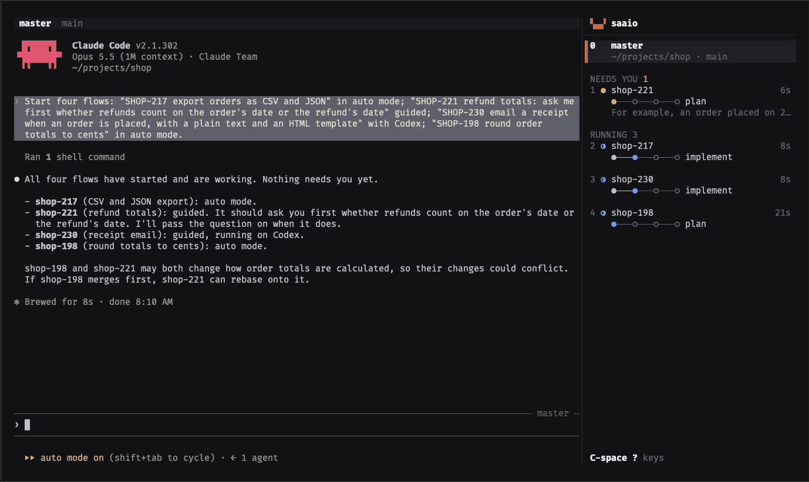

# saaio

Orchestrate coding agents from one terminal. You talk to a master agent. It starts workers, answers
what it can, and asks you the rest.

- One worker per feature, each in its own git worktree and branch
- Sidebar and board show every worker's state and agent
- Phases and skills are configurable, works without any skills
- Claude Code and Codex (experimental), state comes from their hooks
- saaio CLI for agents (TOON) and scripts (--json)

> saaio is young. Expect rough edges, especially with Codex, which is experimental and not yet
> well tested. Bug reports are welcome.


## Install

Requires macOS or Linux, git, and Claude Code or Codex.

```sh
curl -fsSL https://github.com/JanSuthacheeva/saaio/releases/latest/download/install.sh | sh
```

Installs the prebuilt binary to `~/.local/bin`. From source, with Rust 1.95+:

```sh
cargo install --locked --git https://github.com/JanSuthacheeva/saaio --tag v0.1.0
```

More: [docs/install.md](docs/install.md).

> [!IMPORTANT]
> Highly recommended before you start:
>
> 1. Read `~/.config/saaio/config.toml` once. The first run writes it, every setting commented out
>    at its default. Same file: [examples/config.toml](examples/config.toml). Details:
>    [docs/configuration.md](docs/configuration.md).
> 2. Set the recommended permissions in your agents (Claude Code's `settings.json`, Codex's
>    `config.toml`). Workers then run without stopping at every prompt, and saaio works as
>    intended. Details: [docs/agents.md](docs/agents.md).

## Workflow

A worker's first prompt is `/ship-feature <request>` (`$ship-feature` in Codex) by default. Pick one:

**agent-skills.** Installs `ship-feature` and the skills it runs, from
[agent-skills](https://github.com/JanSuthacheeva/agent-skills):

```sh
npx skills add JanSuthacheeva/agent-skills -g --skill ship-feature design-code implement-plan review-changes write-merge-request commit setup-saaio
```

**Your own skills.** In `~/.config/saaio/config.toml`:

```toml
[worker]
prompt = "/my-feature {request}"   # $my-feature in Codex

[[phases]]
name = "plan"
skills = ["my-plan"]

[[phases]]
name = "build"
skills = ["my-build"]

[[phases]]
name = "ship"
skills = ["my-pr"]
```

A phase starts when the worker runs one of its skills. Your phases replace the built-in four.
Details: [Use your own workflow](docs/configuration.md#use-your-own-workflow).

**Neither.** The flow still works. States show as usual. The steps stay `○───○───○───○`.

## Set up each project

Recommended once per project: the `setup-saaio` skill writes `.saaio/setup` and `.saaio/teardown`,
so each worktree gets its own ports, `.env` and services and workers do not collide.

```sh
npx skills add JanSuthacheeva/agent-skills -g --skill setup-saaio   # included in the command above
```

Then ask the agent in the project: "set up saaio for this project". Details:
[Repository setup](docs/repository.md#the-setup-saaio-skill).

## Usage

```sh
saaio    # in a repository
```

| Do | How |
| --- | --- |
| Start a flow | ask the master ("start a flow for SHOP-217 add CSV export"), or `C-space n` |
| List every key | `C-space ?` |
| Detach, sessions keep running | `C-space d` |
| Stop saaio | `C-space Q` or `saaio --stop` |



The sidebar peek and the board's last answer render worker Markdown with terminal text styles:
headings, emphasis, code, lists, quotes and link text fit within their columns.

The first run writes `config.toml`, `theme.toml` and `master.md` to `~/.config/saaio`, every setting
commented out at its default.

## Features

| Feature | What it does |
| --- | --- |
| Master | starts workers, answers them with `saaio send`, is woken when a worker's turn ends, it waits, is blocked, stops responding or opens its merge request. Guided flows bring every question to you. Auto flows let the master answer what the code and plan settle. |
| Worktrees | one branch and worktree per flow. `.saaio/setup` and `.saaio/teardown` run in each. `SAAIO_SLOT` (1 to 20, unique across all projects) gives each worktree its own ports. The `setup-saaio` skill writes both scripts. |
| Hooks | Claude Code and Codex (experimental) report through their own hooks, no screen reading. Codex workers trust saaio's hooks and their own worktree for that launch; a startup dialog that prevents the first turn shows as waiting. Any other command runs as a worker, shown as running or not. If any worker process exits while its flow is working, the flow shows blocked with its exit code and a short tail of pane output. |
| Projects | one store, master and sidebar per git repository, picked from the folder saaio runs in. `saaio status --all` and the board show every project. |
| Plain sessions | an agent in any folder, no worktree, no flow |
| Themes | terminal colors by default, built-in dark and light themes, live reload, themes written by other tools (Noctalia template in the docs) |
| Persistence | sessions keep running when the terminal closes. After a reboot every conversation resumes. |

## How it works

A flow is one unit of work: one feature or ticket, from request to merge request. It has its own
git worktree and branch, a worker (the agent session doing the work) and the phases the worker
walks through (plan, implement, review, merge request by default).

Every flow is an append-only event log. The agents' hooks run `saaio hook`, which turns hook events
into flow events (phase started, question waiting, merge request opened). saaio folds the logs into
each flow's state. `saaio server` runs each agent in its own terminal. `saaio` attaches to it.

## CLI

Every command answers in [TOON](https://toonformat.dev) with suggested next commands:

```
$ saaio status
count: 3
needs_you: 2
flows[3]{name,state,phase,tasks,age,services}:
  shop-221,waiting,plan,"",2s,""
  shop-217,blocked,implement,4/9,2s,""
  scratch,idle,"","",11s,""
blockers[2]{name,blocker}:
  shop-221,Should refunds count against the original order's totals or the refund date's?
  shop-217,"Task 5: the migration needs a default value"
help[2]: "Run `saaio status <name>` for one flow's phases, timeline and decisions",Run `saaio new --name <name> --request <text>` to track a new flow
```

`saaio status --json` is the versioned contract for programs. The CLI and the JSON are the only
public interface. The logs are private.

| Command | Does |
| --- | --- |
| `saaio` | the terminal UI in your terminal. Every flow and what needs you for an agent or a script. |
| `saaio --stop` | stop the server and every session |
| `saaio start <request>` | a worker in its own worktree |
| `saaio start --plain <folder>` | an agent in a folder |
| `saaio status [<flow>] [--json] [--all]` | where flows stand |
| `saaio send <flow> <text>` | tell a worker something |
| `saaio send --type <flow> <line>` | type a line such as `/compact` into a worker's pane |
| `saaio report <event>` | report into a flow by hand |
| `saaio remove <flow>`, `saaio clear` | tear down and forget |
| `saaio bug-report` | a file to attach to a bug report |
| `saaio completions <shell>` | the completion script for bash, zsh, fish, elvish or PowerShell |
| `saaio update` | install the latest release over this binary |

All options: [docs/cli.md](docs/cli.md).

## Similar tools

| Tool | Difference |
| --- | --- |
| Conductor, parallel-code, dmux | diff review and pull requests built in |
| parallel-code | reachable from your phone |
| [firstmate](https://github.com/kunchenguid/firstmate) | a lead agent (the first mate) starts crewmates in their own git worktrees. Shipped as a repository of instructions, skills and scripts you start your agent in. Crewmates run in tmux by default (also herdr, cmux, Zellij, Orca). No dashboard of its own. |
| Claude Squad, ccmanager, amux, herdr | agents side by side in worktrees |

saaio tracks a feature, not a session: phases, task counts, decisions, blockers and a timeline per
flow, from the agents' own hooks. The master is woken instead of polling. Each worktree gets its
own setup, teardown and port slot.

Not in saaio: a diff viewer, a pull request button (the worker's skill opens the merge request and
saaio detects it), desktop notifications, phone access. macOS and Linux only.

## Documentation

- [Install](docs/install.md)
- [The terminal UI](docs/ui.md)
- [Flows and the master](docs/flows.md)
- [Configuration](docs/configuration.md)
- [Agent permissions](docs/agents.md)
- [Themes](docs/themes.md)
- [Repository setup](docs/repository.md)
- [Command line](docs/cli.md)
- [JSON contract](docs/json.md)
- [Files](docs/files.md)
- [Troubleshooting](docs/troubleshooting.md)
- [Changelog](CHANGELOG.md)
- [Roadmap](ROADMAP.md)
- [Contributing](CONTRIBUTING.md)

## License

Licensed under either of

- Apache License, Version 2.0 ([LICENSE-APACHE](LICENSE-APACHE) or
  <https://www.apache.org/licenses/LICENSE-2.0>)
- MIT license ([LICENSE-MIT](LICENSE-MIT) or <https://opensource.org/licenses/MIT>)

at your option.

Unless you explicitly state otherwise, any contribution intentionally submitted for inclusion in
the work by you, as defined in the Apache-2.0 license, shall be dual licensed as above, without
any additional terms or conditions.
