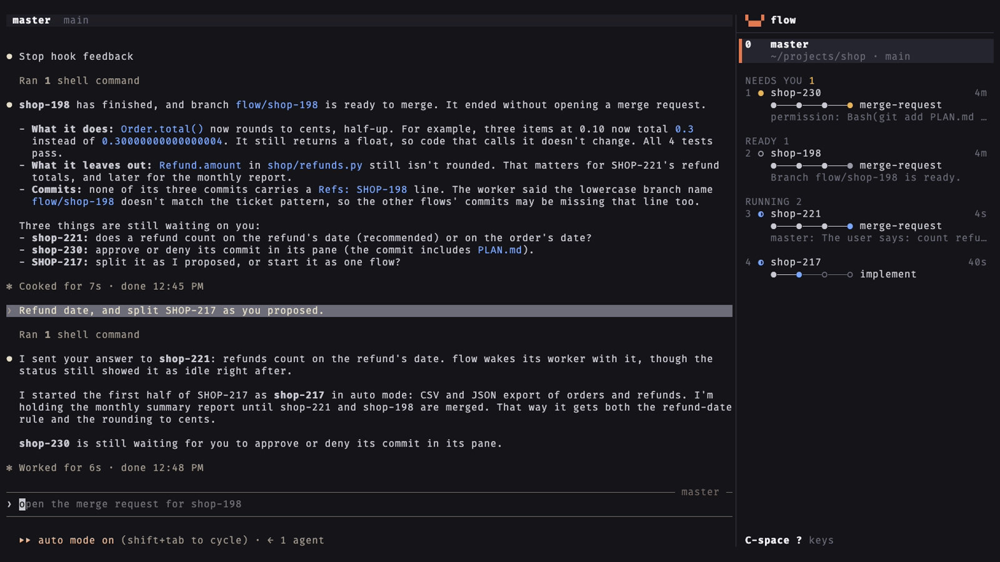
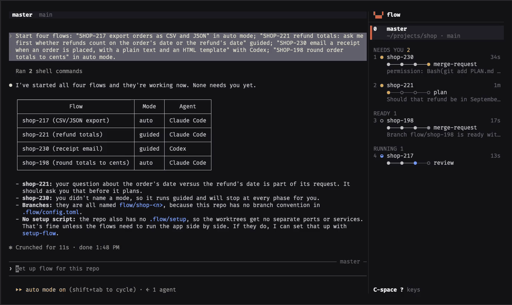

# flow

Orchestrate coding agents from one terminal. You talk to a master agent. It starts workers, answers
what it can, and asks you the rest.

- One worker per feature, each in its own git worktree and branch
- Sidebar shows every worker's state: working, waiting, blocked, idle, done
- Phases and skills are configurable, works without any skills
- Claude Code and Codex, state comes from their hooks
- flow CLI for agents (TOON) and scripts (--json)



## Install

Requires macOS or Linux, git, Rust 1.95+, and Claude Code or Codex.

```sh
cargo install --git https://github.com/JanSuthacheeva/flow --tag v0.1.0
```

## Workflow

A worker's first prompt is `/ship-feature <request>` (`$ship-feature` in Codex) by default. Pick one:

**agent-skills.** Installs `ship-feature` and the skills it runs, from
[agent-skills](https://github.com/JanSuthacheeva/agent-skills):

```sh
npx skills add JanSuthacheeva/agent-skills -g --skill ship-feature design-code implement-plan review-changes write-merge-request commit setup-flow
```

**Your own skills.** In `~/.config/flow/config.toml`:

```toml
[worker]
prompt = "/my-feature {request}"   # $my-feature in Codex

[[phases]]
name = "plan"
skills = ["my-plan"]

[[phases]]
name = "build"
skills = ["my-build"]

[[phases]]
name = "ship"
skills = ["my-pr"]
```

A phase starts when the worker runs one of its skills. Your phases replace the built-in four.
Details: [Use your own workflow](docs/configuration.md#use-your-own-workflow).

**Neither.** The flow still works. States show as usual. The steps stay `○───○───○───○`.

## Usage

```sh
flow ui    # in a repository
flow       # the same, typed in a terminal
```

| Do | How |
| --- | --- |
| Start a flow | ask the master ("start a flow for SHOP-217 add CSV export"), or `C-space n` |
| List every key | `C-space ?` |
| Detach, sessions keep running | `C-space d` |
| Stop flow | `C-space Q` or `flow ui --stop` |



The first run writes `config.toml`, `theme.toml` and `master.md` to `~/.config/flow`, every setting
commented out at its default.

## Features

| Feature | What it does |
| --- | --- |
| Master | starts workers, answers them with `flow send`, is woken when one waits, is blocked or finishes. Guided flows bring every question to you. Auto flows let the master answer what the code and plan settle. |
| Worktrees | one branch and worktree per flow. `.flow/setup` and `.flow/teardown` run in each. `FLOW_SLOT` (1 to 20, unique across all projects) gives each worktree its own ports. The `setup-flow` skill writes both scripts. |
| Hooks | Claude Code and Codex report through their own hooks, no screen reading. Any other command runs as a worker, shown as running or not. |
| Plain sessions | an agent in any folder, no worktree, no flow |
| Themes | terminal colors by default, built-in dark and light themes, live reload, themes written by other tools (Noctalia template in the docs) |
| Persistence | sessions keep running when the terminal closes. After a reboot every conversation resumes. |

## How it works

Every flow is an append-only event log. The agents' hooks run `flow hook`, which turns hook events
into flow events (phase started, question waiting, merge request opened). flow folds the logs into
each flow's state. `flow server` runs each agent in its own terminal. `flow ui` attaches to it.

## CLI

Every command answers in [TOON](https://toonformat.dev) with suggested next commands:

```
$ flow status
count: 3
needs_you: 2
flows[3]{name,state,phase,tasks,age}:
  shop-221,waiting,plan,"",2s
  shop-217,blocked,implement,4/9,2s
  scratch,idle,"","",11s
blockers[2]{name,blocker}:
  shop-221,Should refunds count against the original order's totals or the refund date's?
  shop-217,"Task 5: the migration needs a default value"
help[2]: "Run `flow status <name>` for one flow's phases, timeline and decisions",Run `flow new --name <name> --request <text>` to track a new flow
```

`flow status --json` is the versioned contract for programs. The CLI and the JSON are the only
public interface. The logs are private.

| Command | Does |
| --- | --- |
| `flow` | flow ui in your terminal; every flow and what needs you for an agent or a script |
| `flow ui [--stop]` | the terminal UI |
| `flow start <request>` | a worker in its own worktree |
| `flow start --plain <folder>` | an agent in a folder |
| `flow status [<flow>] [--json] [--all]` | where flows stand |
| `flow send <flow> <text>` | tell a worker something |
| `flow send --type <flow> <line>` | type a line such as `/compact` into a worker's pane |
| `flow report <event>` | report into a flow by hand |
| `flow remove <flow>`, `flow clear` | tear down and forget |

All options: [docs/cli.md](docs/cli.md).

## Similar tools

| Tool | Difference |
| --- | --- |
| Conductor, parallel-code, dmux | diff review and pull requests built in |
| parallel-code | reachable from your phone |
| [firstmate](https://github.com/kunchenguid/firstmate) | a lead agent (the first mate) starts crewmates in their own git worktrees. Shipped as a repository of instructions, skills and scripts you start your agent in. Crewmates run in tmux by default (also herdr, cmux, Zellij, Orca). No dashboard of its own. |
| Claude Squad, ccmanager, amux, herdr | agents side by side in worktrees |

flow tracks a feature, not a session: phases, task counts, decisions, blockers and a timeline per
flow, from the agents' own hooks. The master is woken instead of polling. Each worktree gets its
own setup, teardown and port slot.

Not in flow: a diff viewer, a pull request button (the worker's skill opens the merge request and
flow detects it), desktop notifications, phone access. macOS and Linux only.

## Documentation

- [Install](docs/install.md)
- [flow ui](docs/ui.md)
- [Flows and the master](docs/flows.md)
- [Configuration](docs/configuration.md)
- [Themes](docs/themes.md)
- [Repository setup](docs/repository.md)
- [Command line](docs/cli.md)
- [JSON contract](docs/json.md)
- [Files](docs/files.md)
- [Troubleshooting](docs/troubleshooting.md)
- [Changelog](CHANGELOG.md)
- [Roadmap](ROADMAP.md)

## License

Licensed under either of

- Apache License, Version 2.0 ([LICENSE-APACHE](LICENSE-APACHE) or
  <https://www.apache.org/licenses/LICENSE-2.0>)
- MIT license ([LICENSE-MIT](LICENSE-MIT) or <https://opensource.org/licenses/MIT>)

at your option.

Unless you explicitly state otherwise, any contribution intentionally submitted for inclusion in
the work by you, as defined in the Apache-2.0 license, shall be dual licensed as above, without
any additional terms or conditions.
