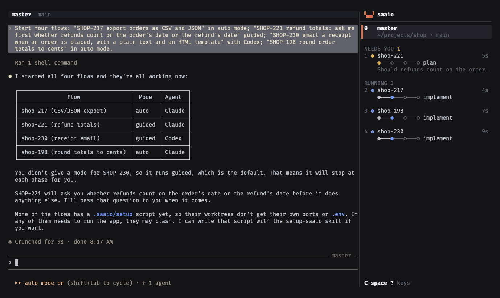

# The terminal UI

```sh
saaio    # in a repository
saaio       # the same, typed in a terminal
```

One terminal with the master, every worker and every plain session.

- [The screen](#the-screen)
- [Keys](#keys)
- [The peek](#the-peek)
- [The board](#the-board)
- [Starting a flow](#starting-a-flow)
- [A session that ended](#a-session-that-ended)
- [History](#history)
- [Mouse](#mouse)
- [Leaving and stopping](#leaving-and-stopping)
- [After a crash or a reboot](#after-a-crash-or-a-reboot)

## The screen



| Area | Shows |
| --- | --- |
| pane (left) | the session in view. The master when the UI opens. Receives all typing except the [prefix key](#keys). |
| title row (above the pane) | worker: state, name, steps, phase, branch, slot. Plain session: state, folder. Master: branch, plus folder while the sidebar is folded. Notices on the right, such as a theme error or "starting the flow…". |
| sidebar (right) | every session, see below |
| rail | the folded sidebar: numbers and marks only. Below 110 columns, or `C-space b`. The title row then names the first flow that needs you and is not in view. |

### Sidebar

Row `0` is the master, with its folder and branch. Spinner while it works. Waiting dot when it ends
a turn, asks something or wants permission while another session is in view, until you look at it.

Workers and plain sessions follow, grouped:

| Group | States |
| --- | --- |
| NEEDS YOU | waiting, blocked, not responding |
| READY | idle: the turn ended, nothing asked |
| RUNNING | working, or a subagent is |
| DONE | finished or ended |

| Row line | Content |
| --- | --- |
| 1 | number (`1` is the top), state, name, age |
| 2 | steps (`●───●───○───○`), phase, task count. Once finished: duration. Plain session: its state, such as `idle`. |
| 3 | what it asks or does |

Rows that do not fit end in `… N more`.

| Mark | State |
| --- | --- |
| spinner (`◐◓◑◒`) | working or delegated |
| `●` in the waiting color | waiting for you |
| `○` | idle: its turn ended, nothing asked |
| `●` in the blocked color | blocked or not responding |
| `✓` | done |
| `○` faint | ended |
| `exited` | the session's process ended |
| `failed` | the session could not start |

## Keys

Prefix: `C-space` unless `[ui] prefix` sets another ([configuration.md](configuration.md#ui)).
Press the prefix, release, press the key.

| Key | Does |
| --- | --- |
| `C-space 0` to `9` | jump to a session. `0` is the master, `1` the top of the sidebar. |
| `C-space j`, `C-space k` | move the [peek](#the-peek) down and up over the workers |
| `C-space enter` | jump into the peeked worker |
| `C-space n` | [start a flow](#starting-a-flow) |
| `C-space o` | open the [board](#the-board) |
| `C-space b` | fold the sidebar to a rail, and back |
| `C-space r` | resume a session that exited, or a flow that ended |
| `C-space [` | scroll back through the session's [history](#history) |
| `C-space d` | detach: leave the UI, every session keeps running |
| `C-space Q` | stop saaio ([Leaving and stopping](#leaving-and-stopping)) |
| `C-space C-space` | send `C-space` to the pane |
| `C-space ?` | show these keys |

Sidebar numbers follow the sort order, so a flow's number changes with its state.

## The peek

| Key | Does |
| --- | --- |
| `C-space j`, `C-space k` | move a cursor over the workers, skipping the one in view |
| `C-space enter` | jump into the selected worker |
| past either end | close the peek |

Under the selected worker: its latest tool calls and text, read from the harness's transcript, not
its screen. Paths in the worker's worktree show relative to it, others in your home folder with ~.

## The board

`C-space o`. A card per session. Below the cards: the selected flow's timeline, decisions and steps.

| Key | Does |
| --- | --- |
| `0` to `9` | select a card |
| `h` `j` `k` `l`, arrows | move between cards |
| `enter` | jump into the selected session |
| `n` | start a flow |
| `x` | clean up the selected flow, if finished |
| `a` | every project's flows, and back to this project ([cli.md](cli.md#several-projects)) |
| `esc`, `q`, `o` | back to the pane |

Other projects' flows are read-only. `enter` and `x` work on this project's flows.

## Starting a flow

`C-space n` opens the new-flow dialog for the repository of the session in view:

```
╭─ new flow ──────────────────────────────────────────── in ~/projects/shop ─╮
│                                                                            │
│▌ request                                                                   │
│▌ ╭──────────────────────────────────────────────────────────────────────╮  │
│▌ │                                                                      │  │
│▌ ╰──────────────────────────────────────────────────────────────────────╯  │
│                                                                            │
│  agent   (•) claude   ( ) codex                                            │
│  mode    ( ) auto   (•) guided   ( ) plain    guided stops at every phase  │
│  creates a branch, a worktree and a slot                                   │
│                                                                            │
├────────────────────────────────────────────────────────────────────────────┤
│  enter start   tab next field   esc cancel                                 │
╰────────────────────────────────────────────────────────────────────────────╯
```

| Row | Holds |
| --- | --- |
| request | what to build, such as `SHOP-217 add CSV export`. Plain mode: the folder to open. |
| type | the branch type, when the repository has a [branch convention](repository.md#branch-names) with types |
| agent | the agent to run, when there is more than one |
| mode | `auto`, `guided` or `plain` ([flows.md](flows.md#guided-and-auto)) |
| creates | the branch, worktree and slot the start creates |

| Key | Does |
| --- | --- |
| typing | edits the request or folder |
| `backspace` | deletes a character |
| `C-w` | deletes the last word, in plain mode the last folder |
| `C-u` | clears the text |
| `tab` | next row |
| `space`, `l`, right arrow | next option in a row |
| `h`, left arrow | previous option |
| `enter` | start, once the text is not empty |
| `esc` | cancel |

`enter` runs `saaio start`. The new session appears in the sidebar. A failed start shows its reason
under the request.

## A session that ended

A worker's pane after `/exit` or a stopped process:

| Key | Does |
| --- | --- |
| `x` | clean up: `saaio remove` for the flow (worktree, branch, flow) |
| `r` | resume the session |
| `esc` | back to the master |

`x` asks before discarding uncommitted changes or commits on no other branch. `y` confirms, any
other key keeps the flow.

The master's session ended: `C-space r` resumes it, `C-space Q` stops saaio.

## History

`C-space [`.

| Key | Does |
| --- | --- |
| `k`, `j`, arrows | one line back, one line forward |
| `C-u`, `C-d` | half a page |
| `C-b`, `C-f` | a page |
| `g`, `G` | oldest line, newest line |
| `q`, `esc` | back to the live session |

## Mouse

- Click a session in the sidebar or rail to jump to it.
- Mouse events in the pane go to the session.

## Leaving and stopping

`saaio server` owns the sessions. The UI is a client.

| Action | Effect |
| --- | --- |
| `C-space d`, or closing the terminal | detach. Sessions keep running. The next `saaio` attaches. |
| `C-space Q` | stop. With unfinished flows it lists them and asks, see below. With every flow finished: `y` stops, any other key cancels. |
| `saaio --stop` | stops the server and every session, keeps unfinished flows (like `k`) |
| a second `saaio` in a terminal | takes over from the first. One UI is attached at a time. |

| Key at the stop prompt | Effect |
| --- | --- |
| `k` | keep: the server stops, sessions resume at the next `saaio` |
| `e` | end: the server stops, flows are marked ended. Branches and worktrees stay until `saaio clear`. |
| `esc` | cancel |

## After a crash or a reboot

The next `saaio` restarts the server and resumes the master and every unfinished worker in its
conversation (`claude --resume`, `codex resume`). After a stop, the master starts a new
conversation. Workers still resume.
