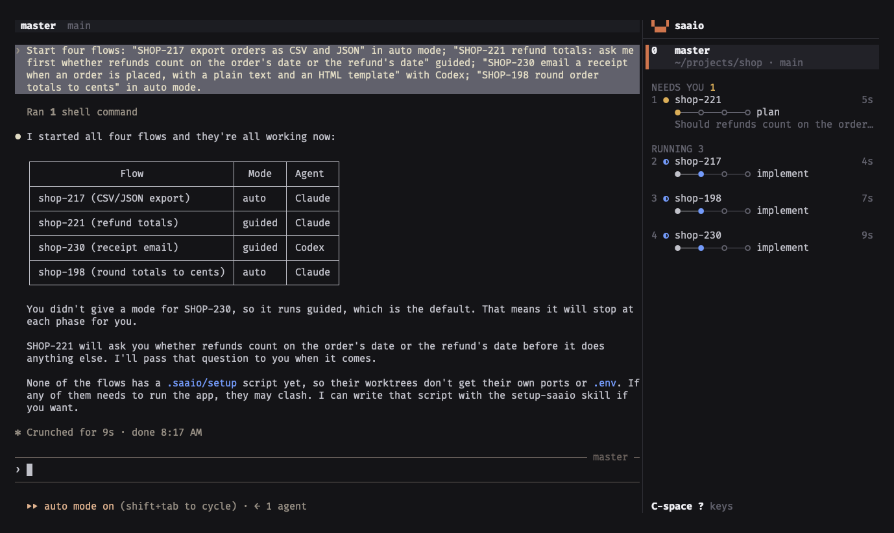

# The terminal UI

- [Introduction](#introduction)
- [The screen](#the-screen)
    - [Sidebar](#sidebar)
- [Keys](#keys)
- [Starting a flow](#starting-a-flow)
- [The peek](#the-peek)
- [The board](#the-board)
- [History](#history)
- [Mouse](#mouse)
    - [Copying](#copying)
- [Notifications](#notifications)
    - [Notifications inside tmux](#notifications-inside-tmux)
    - [Alacritty and Terminal.app](#alacritty-and-terminalapp)
- [A session that ended](#a-session-that-ended)
- [Leaving and stopping](#leaving-and-stopping)
    - [Another saaio](#another-saaio)
- [After a crash or a reboot](#after-a-crash-or-a-reboot)

## Introduction

Running several agents usually means juggling several terminals. saaio puts the master, every
worker and every plain session into one terminal, with a sidebar that shows at a glance which of
them need you. To open it, type `saaio` in a repository:

```sh
saaio    # in a repository, typed in a terminal
```

The UI is for people. Run by an agent or a script, `saaio` prints every flow instead
([cli.md](cli.md#run-by-an-agent-or-a-script)).

## The screen



The session in view takes most of the screen, and the sidebar lists every session beside it:

| Area | Shows |
| --- | --- |
| pane (left) | the session in view. The master when the UI opens. Receives all typing except the [prefix key](#keys). |
| title row (above the pane) | worker: state, name, steps, phase, branch, slot. Plain session: state, name, folder. Master: branch, plus folder while the sidebar is folded. Notices on the right, such as a theme error or "starting the flow…", else mismatched binaries (`server is saaio 0.1.1: saaio --stop`, `another saaio first on PATH`), else a newer release: `0.1.1 is out: saaio update` ([cli.md](cli.md#saaio-update)). |
| sidebar (right) | every session, see below |
| rail | the folded sidebar: numbers and marks only. Below 110 columns, or `C-space b`. The title row then names the first flow that needs you and is not in view. |

### Sidebar

Row `0` is the master, with its folder and branch. It shows a spinner while it works, and a waiting
dot when it ends a turn, asks something or wants permission while another session is in view,
until you look at it. The dot is in the blocked color when its turn failed.

The workers and plain sessions follow, grouped so the ones that need you are on top:

| Group | States |
| --- | --- |
| NEEDS YOU | waiting, blocked, not responding |
| READY | idle: the turn ended, nothing asked |
| RUNNING | working, or a subagent is |
| DONE | finished, a research flow that answered, or ended |

Each session takes three lines:

| Row line | Content |
| --- | --- |
| 1 | number (`1` is the top), state, name, agent (after the kind for one other than feature: `fix claude`), age |
| 2 | steps (`●───●───○───○`), phase, task count. `waits turn` in place of the phase while a heavy command waits for another worker's run ([repository.md](repository.md#heavy-commands)). Once finished: its merge request (`PR #42`, `merged`) or its state, and how long it took. Plain session: its state, such as `idle`. |
| 3 | what it asks or does; while it waits its turn, whose run: `after shop-42: pint` |

Rows that do not fit end in `… N more`. The mark beside each name tells you its state:

| Mark | State |
| --- | --- |
| spinner (`◐◓◑◒`) | working or delegated |
| `●` in the waiting color | waiting for you |
| `○` | idle: its turn ended, nothing asked |
| `●` in the blocked color | blocked or not responding |
| `✓` | done |
| `○` faint | ended |
| `exited`, in place of the age | the session's process ended |
| `failed`, in place of the age | the session could not start. Line 3 says why. |

## Keys

Since the pane receives everything you type, saaio's own commands start with a prefix key, as in
tmux. Press the prefix, release it, then press the key. The prefix is `C-space` unless
`[ui] prefix` sets another ([configuration.md](configuration.md#ui)):

| Key | Does |
| --- | --- |
| `C-space 0` to `9` | jump to a session. `0` is the master, `1` the top of the sidebar. |
| `C-space j`, `C-space k` | move the [peek](#the-peek) down and up over the workers |
| `C-space enter` | jump into the peeked worker |
| `C-space n` | [start a flow](#starting-a-flow) |
| `C-space o` | open the [board](#the-board) |
| `C-space b` | fold the sidebar to a rail, and back |
| `C-space r` | resume the session in view when it is not running: the master, or a worker whose flow is unfinished |
| `C-space [` | scroll back through the session's [history](#history) |
| `C-space d` | detach: leave the UI, every session keeps running |
| `C-space Q` | stop saaio ([Leaving and stopping](#leaving-and-stopping)) |
| `C-space C-space` | send `C-space` to the pane |
| `C-space ?` | show these keys |

> [!NOTE]
> Sidebar numbers follow the sort order, so a flow's number changes with its state.

## Starting a flow

`C-space n` opens the new-flow dialog for the repository of the session in view. Type the request,
and press `enter`:

```
╭─ new flow ──────────────────────────────────────────── in ~/projects/shop ─╮
│                                                                            │
│▌ request                                                                   │
│▌ ╭──────────────────────────────────────────────────────────────────────╮  │
│▌ │                                                                      │  │
│▌ ╰──────────────────────────────────────────────────────────────────────╯  │
│                                                                            │
│  kind    (•) feature   ( ) fix   ( ) research                              │
│  agent   (•) claude   ( ) codex                                            │
│  base    main (checked out)                                                │
│  mode    ( ) auto   (•) guided   ( ) plain    guided stops at every phase  │
│  creates a branch, a worktree and a slot                                   │
│                                                                            │
├────────────────────────────────────────────────────────────────────────────┤
│  enter start   tab next field   esc cancel                                 │
╰────────────────────────────────────────────────────────────────────────────╯
```

`enter` runs `saaio start`, and the new session appears in the sidebar. A failed start shows its
reason under the request. The other rows have sensible defaults, and you only change the ones you
need:

| Row | Holds |
| --- | --- |
| request | what to build, such as `SHOP-217 add CSV export`. Plain mode: the folder to open. |
| kind | the [kind of flow](flows.md#kinds): `feature`, `fix`, `research` and the config's, the default first |
| type | the branch type, when the repository has a [branch convention](repository.md#branch-names) with types and the kind a branch. Follows the kind: `bugfix` for a fix when the repository lists it. |
| agent | the agent to run, when there is more than one |
| base | the branch the flow starts from and its merge request targets ([flows.md](flows.md#stacked-flows)). Empty: what the repository has checked out, shown faint. Up and down put in the branch of one of the repository's unfinished flows, the one in view first. |
| mode | `auto`, `guided` or `plain` ([flows.md](flows.md#guided-and-auto)) |
| creates | the branch, worktree and slot the start creates, filled in once you type, or `every slot is taken`; `no branch` for a research flow. Plain mode: where the session opens. |

In the dialog, these keys work:

| Key | Does |
| --- | --- |
| typing | edits the request, folder or base |
| `backspace` | deletes a character |
| `C-w` | deletes the last word, in plain mode the last folder, in the base the part after the last `/` |
| up, down arrow | in the base row: the previous or next flow's branch, then empty again |
| `C-u` | clears the text |
| `tab` | next row |
| `space`, `l`, right arrow | next option in a row, wrapping around |
| `h`, left arrow | previous option, wrapping around |
| `enter` | start, once the text is not empty |
| `esc` | cancel |

In plain mode the dialog is titled `new session`, the text row is `folder`, prefilled with the
folder in view, and the kind, type and base rows are hidden.

## The peek

Often you only want to know what a worker is up to, without leaving the session you are in. The
peek shows it in the sidebar:

| Key | Does |
| --- | --- |
| `C-space j`, `C-space k` | move a cursor over the workers, skipping the one in view |
| `C-space enter` | jump into the selected worker |
| past either end | close the peek |

Under the selected worker you see its latest tool calls and text, read from the harness's
transcript, not its screen. Paths in the worker's worktree show relative to it, others in your
home folder with ~. For a finished flow, its branch and worktree (`gone` once removed) come first.
The peek shows in the sidebar only, not on the rail.

## The board

The board, `C-space o`, is the overview: a card per session. Below the cards is the selected
flow's story: its phases and how long each took, its timeline, decisions and last answer. Its
header names its request, kind, mode, agent, branch, `on <base>` for a
[stacked flow](flows.md#stacked-flows), slot and merge request.

| Key | Does |
| --- | --- |
| `0` to `9` | select a card, on this project's board |
| `h` `j` `k` `l`, arrows | move between cards |
| `enter` | jump into the selected session |
| `n` | start a flow |
| `x` | clean up the selected flow, if finished |
| `a` | every project's flows, and back to this project ([cli.md](cli.md#several-projects)) |
| `esc`, `q`, `o` | back to the pane |

Other projects' flows are read-only: `enter` and `x` work on this project's flows.

A flow whose services saaio paused ([repository.md](repository.md#pause-and-resume)) says so
beside its state on its card: `ready · paused`, `working · resuming`, or `working · services down`
when the resume failed. The selected flow's header says since when (`services paused 14:02`),
`services resuming`, or why the resume failed (`services down: port 8003 is taken`). The sidebar
does not show it.

A flow whose heavy command waits for another worker's run
([repository.md](repository.md#heavy-commands)) says `working · waits turn` on its card. Its header
says what, since when and whose run:

```
waits its turn for pint since 14:02; shop-42 runs
```

## History

A session's output scrolls on, and saaio keeps its last 10,000 lines. `C-space [` scrolls back
through them, and so does the wheel over a pane whose session leaves the mouse to saaio and is not
on the alternate screen:

| Key | Does |
| --- | --- |
| `k`, `j`, arrows | one line back, one line forward |
| `C-u`, `C-d` | half a page |
| `C-b`, `C-f` | a page |
| `g`, `G` | oldest line, newest line |
| `q`, `esc` | back to the live session |

## Mouse

saaio takes the mouse while it runs, like tmux with `mouse on`:

| Action | Does |
| --- | --- |
| Click a session in the sidebar or rail | jumps to it |
| Drag | selects text and copies it when you let go |
| Double-click, triple-click | copies a word, a line |
| Wheel over the pane | scrolls the history; down past the newest line goes back to the live session. A program on the alternate screen, such as `less`, gets arrow keys instead |

A selection stays inside what it started in: a dialog, the board, the title row, the pane, the
sidebar or the rail. It stays highlighted until the next key or click.

A session that uses the mouse itself, such as Claude Code or Codex, gets the clicks, drags and
wheel in its pane, and selects and copies on its own. What it copies with OSC 52, as Claude Code
does over SSH, reaches your clipboard while it is the focused session.

### Copying

saaio copies with OSC 52, which works over SSH too, and locally also with `pbcopy` on macOS, or
`wl-copy` or `xclip` on Linux. To use the terminal's own selection instead, hold Shift while you
drag (Option in iTerm2 and Terminal.app). It can span the pane and the sidebar.

| Terminal | OSC 52 copy | Terminal's own selection |
| --- | --- | --- |
| Alacritty | yes | Shift-drag |
| Ghostty | yes | Shift-drag |
| kitty | yes | Shift-drag |
| WezTerm | yes | Shift-drag |
| iTerm2 | after Settings > General > Selection > "Applications in terminal may access clipboard" | Option-drag |
| Terminal.app | no | Option-drag |

Over SSH, OSC 52 is the only way to your clipboard, so in Terminal.app use Option-drag. Inside
tmux, OSC 52 needs one line in `~/.tmux.conf`:

```
set -g set-clipboard on
```

## Notifications

You don't have to keep an eye on the sidebar. When a flow starts waiting or is blocked while you
aren't looking at it, saaio has your terminal raise a desktop notification:

```
shop-230 asks: Which approach?
shop-230 waits for you
shop-230 is blocked: migration needs a default
```

The master raises one too when it waits or is blocked, never when it only comes to rest.

You aren't looking at a flow when another session is in view, or when the terminal window has lost
focus, which then counts for the session in view too. saaio raises one notification per change: a
flow that stays waiting raises no second one, a waiting flow that becomes blocked does, and so does
a new flow that is blocked from the start, such as one whose setup failed. Attaching raises none
for what was already waiting. To turn them off, set `notify` in config.toml
([configuration.md](configuration.md#ui)):

```toml
[ui]
notify = false
```

saaio writes the one escape sequence your terminal turns into a notification, picked from `TERM`
and `TERM_PROGRAM` first, then `VTE_VERSION` and `ALACRITTY_WINDOW_ID`:

| Terminal | Sent |
| --- | --- |
| Ghostty, iTerm2, kitty, WezTerm, and any terminal not named below | OSC 9 |
| foot, urxvt, VTE terminals such as GNOME Terminal | OSC 777 |
| Alacritty, Terminal.app | the bell |

A terminal that does not know the sequence ignores it. Whether a notification shows while the
terminal has focus, and how it looks, is up to the terminal and the system's notification settings.

### Notifications inside tmux

Inside tmux, the variables are those of the terminal that started the tmux server, so saaio asks
tmux which terminal is attached, by its `TERM` and the version it told tmux
(`#{client_termname}`, `#{client_termtype}`). An attached terminal that told no version, such as
Alacritty or Terminal.app, gets the bell.

saaio sends OSC 9 and OSC 777 through tmux's passthrough, and tmux tells saaio when its window or
the terminal loses focus. Both need a line in `~/.tmux.conf`:

```
set -g allow-passthrough all
set -g focus-events on
```

Without `allow-passthrough` tmux drops the notifications silently, and with `on` instead of `all`
it drops them while saaio's window is not the one in view. Without `focus-events`, the session in
view never notifies. The bell needs nothing.

### Alacritty and Terminal.app

Alacritty and Terminal.app have no notification sequence, so saaio rings the bell. Alacritty then
asks for attention while it is not focused: the Dock icon bounces on macOS, the window is marked
urgent on Linux. For a real notification, have Alacritty run a command on every bell in
`alacritty.toml`:

```toml
[bell]
# macOS
command = { program = "osascript", args = ["-e", "display notification \"a flow needs you\" with title \"saaio\""] }
# Linux
# command = { program = "notify-send", args = ["saaio", "a flow needs you"] }
```

It runs for any program's bell, not only saaio's. Terminal.app does what Settings > Profiles >
Advanced > Bell says, such as badging its icon or bouncing it while in the background.

## A session that ended

A worker's pane after `/exit`, after its process stopped, or after a start that failed
(`could not start`) offers what you can do next:

| Key | Does |
| --- | --- |
| `x` | clean up: `saaio remove` for the flow (worktree, branch, flow) |
| `r` | resume the session if its flow is unfinished |
| `esc` | back to the master |

`x` asks before discarding uncommitted changes or commits on no other branch: `y` confirms, any
other key keeps the flow.

> [!NOTE]
> A finished flow (`done` or `ended`) cannot be reopened, since its slot may already belong to
> another flow. Start a new flow to continue the work.

When the master's session ended, `C-space r` resumes it, and `C-space Q` stops saaio. A flow saaio
has no session for shows `not open`: `C-space r` resumes it, `C-space 0` goes back to the master.

## Leaving and stopping

The sessions belong to `saaio server`, not to the UI, which is only a client. That is why you can
close the UI without stopping a single worker. `C-space d`, or closing the terminal, detaches:
the sessions keep running, and the next `saaio` attaches again. A second `saaio` in a terminal
takes over from the first, since one UI is attached at a time.

To stop saaio itself, press `C-space Q`. With every flow finished, `y` stops and any other key
cancels. With unfinished flows, it lists them and asks what to do with them:

| Key at the stop prompt | Effect |
| --- | --- |
| `k` | keep: the server stops, sessions resume at the next `saaio` |
| `e` | end: the server stops, flows are marked ended. Branches and worktrees stay until `saaio clear`. |
| `esc` | cancel |

From the shell, `saaio --stop` stops the server and every session, and keeps unfinished flows,
like `k`:

```sh
saaio --stop
```

### Another saaio

When the UI attaches, it compares itself with the server and with the first `saaio` on PATH. If
the server is another build, such as one started before `saaio update`, or another build comes
first on PATH, such as an old `cargo install` in `~/.cargo/bin`, a `mismatched saaio` dialog names
each binary with its build and what to do. Any key closes it, and the title row keeps a short line
until the UI quits.

The UI only warns: `saaio --stop` ends every session, so you choose when
([troubleshooting.md](troubleshooting.md#the-terminal-ui)).

## After a crash or a reboot

A crash or a reboot does not cost you your flows. The next `saaio` restarts the server and resumes
the master and every unfinished worker in its conversation (`claude --resume`, `codex resume`). After a
stop, the master starts a new conversation, and the workers still resume.
